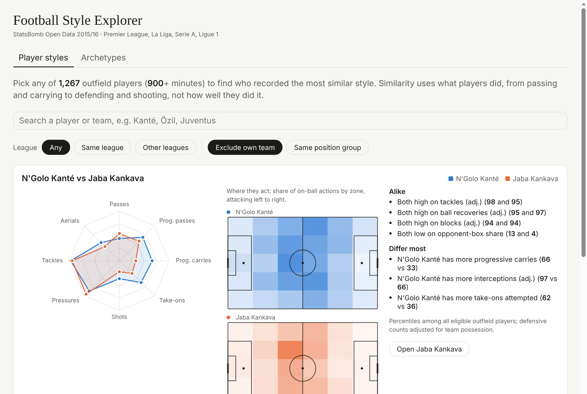
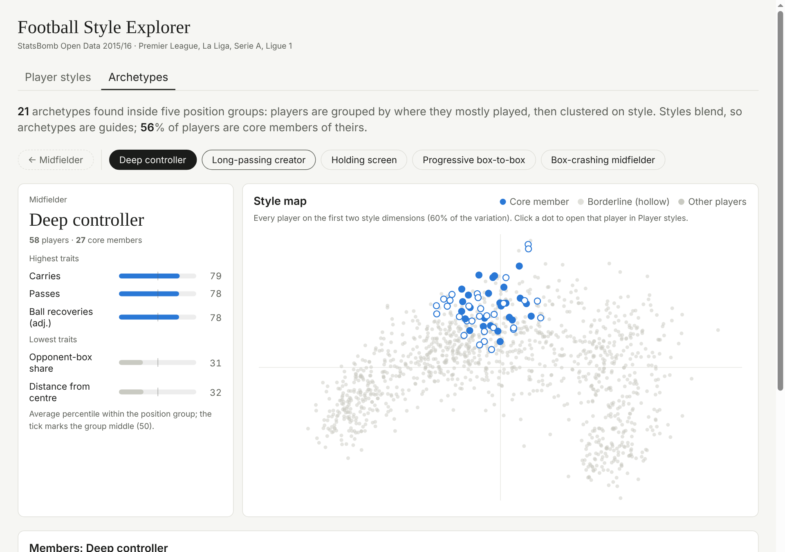
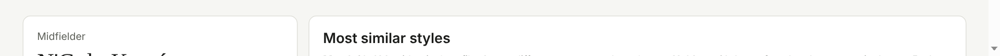

# Football Style Explorer

**Which players play like whom?** A data-driven scouting tool that profiles 1,267 outfield players from Europe's top leagues, groups them into 21 playing-style archetypes, and finds each player's closest stylistic matches, with an honest measure of how much to trust every match.

**[▶ Open the live explorer](https://markisinc.github.io/football-player-archetypes/)** · [Methodology](docs/METHODOLOGY.md)



## What it does

- **Similar-player search.** Pick a player and get the 10 most similar styles. Each match shows a score, a "holds up" percentage (how often it survives when the season is resampled), a radar comparison, and a plain-language note on what is alike and what differs. You can filter by league, exclude the player's own team, or stay within a position group.
- **Archetypes.** 21 styles found *within* five position groups, such as *Ball-playing centre-back*, *Deep controller*, *Dribbling winger* and *Mobile front-line finisher*. Each player is marked as a core or borderline member.
- **Style map.** Every player on the two main style dimensions, with the selected archetype highlighted. Click a dot to explore that player.

| Archetypes and style map | Player profile and closest matches |
|---|---|
|  |  |

## Key results

| | |
|---|---|
| Data | 1,517 matches, 2015/16 Premier League, La Liga, Serie A, Ligue 1 |
| Players | 1,267 outfield players with 900+ minutes |
| Style measures | 27, compressed to 8 dimensions (87% of the variation) |
| Archetypes | 21 across 5 position groups; 56% of players are core members |
| Validation | 30 whole-match resamples: archetype agreement (ARI) 0.39 to 0.69 by group; 37% of top-5 neighbours survive on average |

Example matches the model finds: Benzema ↔ Suárez, Özil ↔ David Silva, Messi ↔ Hazard / Insigne / Neymar, Cristiano Ronaldo ↔ Sturridge / Agüero.

## How it works

```
StatsBomb events + lineups ──► minutes per player (from lineups, data quirks handled)
        │
        ▼
27 style measures per 90 (possession-adjusted defending; goals/xG kept out as context only)
        │
        ▼
cap outliers → standardise → PCA (≥85% variance)
        │
        ├──► similarity = distance in style space, per-neighbour stability from 30 match resamples
        └──► archetypes = k-means within each position group, k chosen for reproducibility
```

Choices worth calling out (details in [METHODOLOGY.md](docs/METHODOLOGY.md)):

- **Style, not quality.** Goals, xG and success rates are shown as context but excluded from similarity, so two players doing the same job aren't pushed apart by one good finishing season.
- **Two-level archetypes.** Clustering everyone at once just rediscovers positions. Clustering inside each position group surfaces the differences that matter (a *Deep controller* vs a *Box-crashing midfielder*).
- **Picking the number of archetypes.** Silhouette scores always favoured two groups, because styles form a continuum. The model instead uses the most detailed split that stays reproducible across random starts.
- **Honest uncertainty.** With about 30 matches per player, per-90 rates are noisy. Every suggestion carries its own stability score instead of pretending rank #1 is certain.

## Run it yourself

```bash
pip install -r requirements.txt
python src/sb_load.py          # download ~1,500 matches from StatsBomb Open Data (~5 min, ~320 MB)
python src/sb_profiling.py     # build profiles, archetypes, neighbours, 30 resamples (~5-10 min)
python -m unittest discover -s tests -p "test_sb*.py" -v
```

Then open the explorer locally:

```bash
cd docs && python -m http.server 8000     # → http://127.0.0.1:8000
```

`src/sb_export_dashboard.py` also writes tidy CSVs (players, neighbours, archetypes) for BI tools.

## Repository layout

```
├── src/
│   ├── sb_load.py              # download + flatten StatsBomb events and lineups
│   ├── sb_profiling.py         # minutes, features, PCA, archetypes, neighbours, validation
│   └── sb_export_dashboard.py  # tidy CSV exports
├── tests/test_sb_profiling.py  # minutes logic, rate maths, output invariants
├── outputs/profiling_sb/       # results: player profiles, archetypes, stability checks
├── docs/                       # GitHub Pages site: the explorer + methodology
└── .github/workflows/tests.yml # CI
```

## Limitations

- One season (2015/16). The Bundesliga is excluded because StatsBomb's open release for that season covers only one team.
- Event data can't see off-ball movement or tactical instructions. "Similar" means a similar recorded pattern of actions, not "could replace".
- Team and league context still leak in slightly: 29% of top-5 matches share a league vs 25% by chance.

## Data & credits

Data provided by **StatsBomb**: [StatsBomb Open Data](https://github.com/statsbomb/open-data).
<!-- Add the StatsBomb logo from their Media Pack here, as their terms request. -->

Built by John Akinyemi · [LinkedIn](https://www.linkedin.com/in/johnoakinyemi) · MIT licence (code only).
